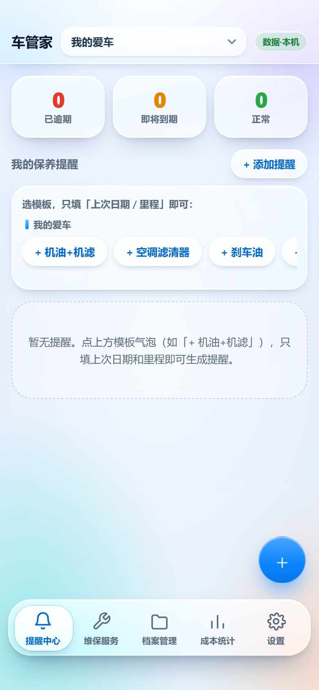
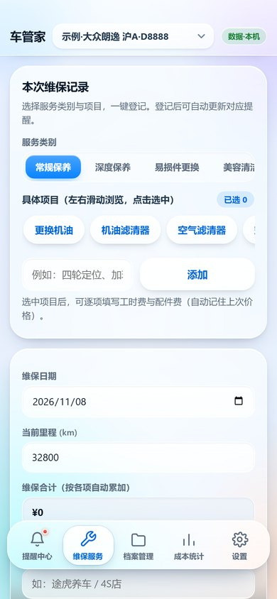
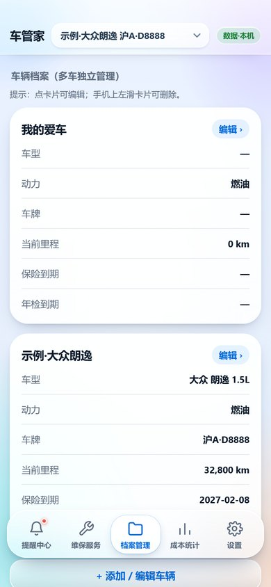
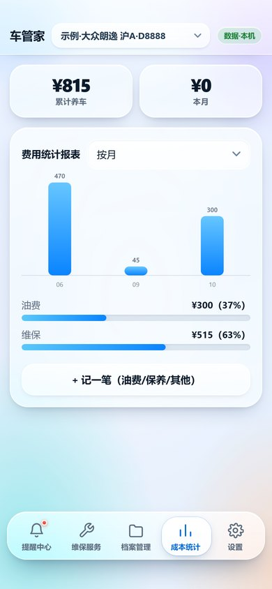
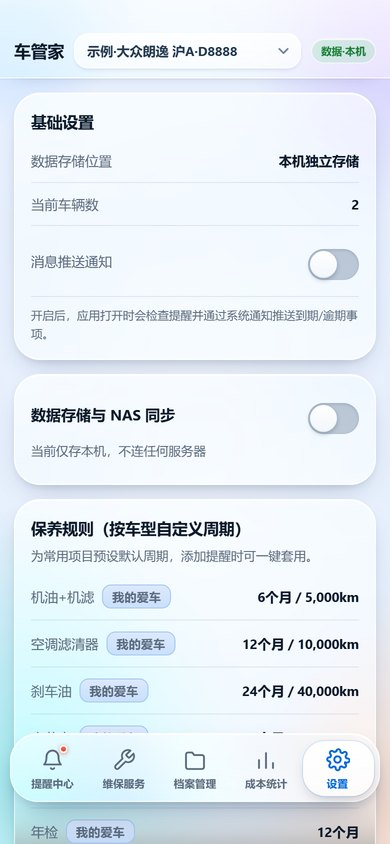

# 车管家 Android（CarCare）

汽车维修保养记录与智能提醒的 **Android 原生 App**，界面与功能跟
[iOS 版](https://github.com/zsonit/carcare-ios)、网页版逐项一致。
页面沿用开源项目 [kenowong/car-maintenance](https://github.com/kenowong/car-maintenance)（MIT），
外层是原生 Android 外壳：内置页面通过本机 HTTP 服务加载，浏览器能力由原生桥接补上。

| 提醒中心 | 维保服务 | 档案管理 | 成本统计 | 设置 |
| --- | --- | --- | --- | --- |
|  |  |  |  |  |

## 与 iOS 版同一套界面

整站视觉是 iOS 27 液态玻璃（Liquid Glass）：柔和光斑壁纸、`backdrop-filter` 玻璃卡片、
悬浮玻璃胶囊导航（选中项是一个滑行的白色「镜头」）、底部玻璃 sheet、胶囊按钮与 iOS 尺寸开关。
Android 版直接复用同一份 `index.html`，所以两端像素级一致，连导航滑行动画都相同。

两处平台差异由原生补齐：

| 差异 | Android 处理 |
| --- | --- |
| `env(safe-area-inset-*)` 在 WebView 里恒为 0 | 原生读状态栏 / 导航栏高度，换算成 CSS px 注入 6 条 `!important` 规则，顶栏与底部导航才会正确避让刘海和手势条 |
| 通知权限是运行时授权（Android 13+） | `Notification.requestPermission()` 桥到系统授权弹窗，结果回填给网页的 Promise |

## 功能对照（与 iOS / 安卓网页版完全一致）

| 模块 | 功能 |
| --- | --- |
| 提醒中心 | 逾期 / 即将到期 / 正常统计、按车型分组的保养模板气泡、双维度（日期 + 里程）提醒、进度条、编辑 / 已保养顺延 / 删除 |
| 维保服务 | 按动力类型（燃油 / 油电混动 / 插电混动 / 纯电）自动切换服务目录、项目多选、自定义项目、逐项工时费 + 配件费、上次价格记忆、里程自动同步、同名提醒自动顺延 |
| 档案管理 | 多车档案（左滑删除）、车牌省简称 + 号码、VIN、购买日期、保险 / 年检到期自动生成提醒、维保记录列表与凭证缩略图 |
| 成本统计 | 累计 / 本月养车费用、按类别占比、按月 / 按年柱状图、手动记账（油费 / 保险 / 维修 / 停车过路 / 其他） |
| 设置 | 保养规则（按车型自定义周期）、消息推送、导出 CSV、导出 PDF、导入备份、示例数据、清空数据 |
| NAS 同步 | 本机 + NAS 双份存储、服务器地址 + 访问密钥、测试连接 / 立即同步 / 上次同步状态 |

## Android 侧的原生适配（网页做不到的部分）

| 网页能力 | Android 实现 |
| --- | --- |
| `localStorage` 持久化 | `LocalAssetServer` 用 `ServerSocket` 在 `http://127.0.0.1:48700` 提供 assets 内的页面，得到正常同源环境（与 iOS 版同一套做法，不是 `file://`） |
| `confirm` / `alert` / `prompt` | `GlassDialog`：底部玻璃卡片弹窗，与 App 内其它弹窗同款（含抓取条、圆角、滑入动画、水波纹） |
| 收据 / 发票凭证上传、导入备份 | `WebChromeClient.onShowFileChooser` + 系统相册 / 文件选择器，并附「拍照」快捷入口（`ShareProvider` 提供 content:// 输出） |
| 导出 CSV | 截获 `blob:` 下载，写入 `cache/share`，弹「保存到「文件」/ 发送到其它 App」玻璃面板 |
| 导出 PDF | 交给系统打印框架（`PrintManager` + WebView 打印适配器），在打印页选「另存为 PDF」即得矢量 PDF，也可直接打印 |
| 查看凭证大图 | `ImageViewerActivity` 全屏看图，轻点关闭，可分享 |
| 消息推送通知 | `Notification` API 桥到系统通知通道（HIGH 优先级、可点击回到 App） |
| 安装到主屏卡片 | 隐藏（本身就是独立 App） |
| NAS 局域网访问 | `usesCleartextTraffic` + `MIXED_CONTENT_ALWAYS_ALLOW`，页面是 http 本机源，访问 `http://192.168.x.x` 不会被拦 |

## 目录结构

```
app/src/main/java/com/zsonit/carcare/
  MainActivity.java        窗口（边到边）/ WebView 配置 / 文件选择 / 权限
  LocalAssetServer.java    零依赖本机 HTTP 服务（ServerSocket），并注入 Android 桥接脚本
  CarBridge.java           JS ↔ 原生：通知 / 导出 / 看图 / 安全区
  GlassDialog.java         底部玻璃卡片弹窗（alert / confirm / prompt / 动作列表）
  PdfExporter.java         HTML → 系统打印（另存为 PDF）
  ImageViewerActivity.java 全屏凭证图
  ShareProvider.java       导出文件的 content:// 提供者（替代 FileProvider）
app/src/main/assets/web/   内置网页（index.html + cc-android.js + 图标）
tools/                     图标生成、网页同步、无设备截图校验、一键构建
keystore/                  发布签名（多机 / CI 出的包签名一致，才能覆盖升级）
.github/workflows/build-apk.yml   Actions 出包
```

## 构建

本机（Windows，无需安装 Android Studio）：

```bash
./tools/build.sh        # 产物：dist/CheGuanJia-Android-v2.2.0-b1.apk
```

或推到 GitHub 让 Actions 出包：`git push origin main` → Actions → `carcare-android-apk`。

签名用仓库内 `keystore/carcare-release.jks`（alias `carcare`），
密码可用 `-PCC_STORE_PASS=... -PCC_KEY_PASS=...` 覆盖。

## 安装

`dist/CheGuanJia-Android-v2.2.0-b1.apk` 直接发到手机安装即可（允许「未知来源」）。
包名 `com.zsonit.carcare`，与 iOS 版 bundle id 对应，和上游的 `com.kenowong.carcare`
是两个独立 App（可共存，数据互不影响）。

## 网页资源升级

上游 / iOS 工程页面更新后：

```bash
./tools/sync-web.sh                    # 默认取 ../carcare-ios/Resources/web
./tools/build.sh
```

## 许可

页面与功能设计来自 kenowong/car-maintenance（MIT）。Android 外壳代码同样以 MIT 发布。
